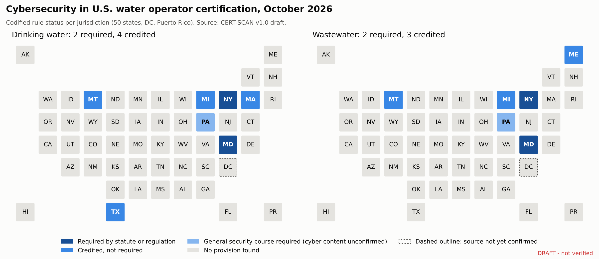
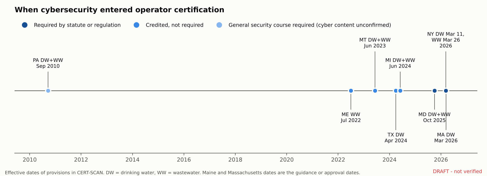

{draft_banner}

# Abstract

Drinking water and wastewater systems in the United States are run by state-certified operators, and the systems they control are increasingly targeted by cyberattacks. Yet there has been no national record of whether state certification programs require operators to know anything about cybersecurity. The last national summary of state programs, EPA 816-R-16-002 (March 2016, {epa2016_pages} pages), contains no use of the word "cyber." CERT-SCAN fills this gap. It records, for all 50 states, the District of Columbia and Puerto Rico, and separately for drinking water and wastewater ({n_rows} records), whether cybersecurity is required, credited, or absent in operator certification, with a citation to the governing statute, rule, or agency document behind every record. As of {accessed}, {n_req_juris_w} jurisdictions require cybersecurity training by statute or regulation: {req_list}. {n_cred_juris_W} credit it without requiring it: {cred_list}. {n_gen_juris_W}, {gen_list}, requires a general security course whose cybersecurity content is unconfirmed. The remaining jurisdictions have no provision in the sources reviewed. The record also shows a gap between testing and training: the 2025 exam outlines of Water Professionals International (WPI), whose exams are used for {n_wpi_dw} drinking water programs, list a cybersecurity task for water treatment operators, while no wastewater exam outline does. CERT-SCAN is released openly and will be updated annually.

# Background and summary

Under Safe Drinking Water Act section 1419 and EPA's 1999 operator certification guidelines (64 Fed. Reg. No. 24), a state that does not run an operator certification program meeting the guidelines loses part of its Drinking Water State Revolving Fund allotment. States therefore certify the operators of community and non-transient non-community water systems. Wastewater operators are certified under separate state authorities. Each state sets its own qualifications, examinations, and renewal training. That makes certification one of the few policy levers that reaches every operator at every regulated system, including small systems with no dedicated information technology staff.

Water systems increasingly depend on networked control systems, and attacks on them have become more frequent and more visible. In the summer of 2026, coordinated cyberattacks targeted water systems in at least twelve states. States have responded mainly at the utility level, with risk assessments, incident reporting, and cybersecurity plans. Whether they have also changed what operators must know to hold a license has not been tracked anywhere.

EPA last summarized all state operator certification programs in March 2016 (EPA 816-R-16-002). A scripted search of that report finds {epa2016_cyber} uses of "cyber," {epa2016_security} use of "security," and {epa2016_scada} use of "SCADA." The single security reference is Pennsylvania's requirement that every certified operator complete a Department-approved system security course, in force since 2010. CERT-SCAN establishes a current, citable baseline against which future changes can be measured, and commits to updating it each year.

# Methods

## Scope and unit of observation

The unit is a jurisdiction by program: 50 states, the District of Columbia, and Puerto Rico, each recorded once for drinking water and once for wastewater ({n_rows} records). Where one body certifies both groups under one rule, both records carry the same citation, so counts by program always total {n_juris}.

## What was coded

Each record is assigned one of five levels, coded only on codified or official instruments:

- **Required:** a statute or regulation makes cybersecurity-specific training, coursework, or demonstrated knowledge a condition of obtaining or renewing certification.
- **Credited, not required:** a rule, official guidance, or published course approval names cybersecurity as eligible for certification credit.
- **General security only:** a codified security-training condition exists, but its cybersecurity content is not established.
- **No provision found:** no provision was identified in the sources reviewed. This is a statement about the evidence, not a claim of absence.
- **Unknown:** sources could not be read or conflicted.

Agency practice without a written rule does not on its own qualify a record as required; such practice is recorded in a separate column. For required records, CERT-SCAN also records the mechanism (initial and renewal training, renewal hours, one-time course), hours, renewal cycle, classes covered, effective date, and instrument type (statute, regulation, guidance, or board practice).

## Search and source protocol

Each record rests on at least one state-specific source: the renewal or continuing-education rule where it could be read, otherwise the certifying body's program page or renewal form. Sources were located by web search, downloaded where possible, and logged with their URL, access date, size, and SHA-256 fingerprint. Text was scanned by script for cybersecurity terms (cyber, SCADA, control system, operational technology, ransomware, malware, network or information security) and read in full wherever terms appeared. Pages that blocked automated access were read through a web reader. Nine nationwide searches were run in addition to identify statutes, rules, bills, and agency notices that might not appear in a state's rule chapter. All queries are listed in the repository's search log.

## Exam content

For each jurisdiction, the exam provider was identified from the regulatory member list of Water Professionals International (WPI, formerly the Association of Boards of Certification exam service). The 2025 WPI need-to-know criteria (exam content outlines) for water treatment, water distribution, wastewater treatment, and wastewater collection, classes 1 to 4, were downloaded and searched for cybersecurity tasks.

## Verification

The records carrying the main findings (Maryland, New York, Pennsylvania) were checked by the author against their primary legal texts. Every record states its confidence (high: primary legal text read; medium: official agency document read; low: source not yet confirmed) and whether the author has verified it.

# Data records

The dataset is a single CSV file (`cert_scan_v1.csv`, {n_rows} rows) with a codebook defining every column. Supporting files include the extracted 2016 EPA state profiles, the state source list, the scripted scan results, a provenance log for every downloaded source, a search log, a quality-assurance report, and the two figures in this paper. All are in the repository and in the archived release ({doi}).

# Results

**Required.** {n_req_juris_W} jurisdictions require cybersecurity knowledge for operator certification by statute or regulation, in both programs:

{table_required}

Maryland's statute (2025 Md. Laws ch. 495, Environment Article section 9-2702(2)) took effect on 1 October 2025 and directs the Department of the Environment to include cybersecurity awareness components in all new and renewing operator certifications; the operator board had already required EPA cybersecurity training at renewal from July 2025. New York's Department of Health and Department of Environmental Conservation followed in March 2026 with regulations specifying hours, renewal cycles, and approved curricula.

**Credited, not required.** {n_cred_juris_W} jurisdictions credit cybersecurity training toward renewal without requiring it: {cred_list}. In Texas, cybersecurity is a permitted element of a resiliency training requirement that has applied to water operators since April 2024.

**General security only.** Pennsylvania has required a one-time system security course for every certified operator since 18 September 2010 (25 Pa. Code section 302.804). Whether the course covers cybersecurity has not been confirmed.

**No provision found.** In the remaining jurisdictions ({n_none_dw} drinking water and {n_none_ww} wastewater records), no cybersecurity provision was found in the sources reviewed.

**Testing ahead of training.** In the 2025 WPI exam outlines, all four water treatment classes list "perform cyber security according to industry standards" as a task. No distribution, wastewater treatment, or collection outline mentions cybersecurity. WPI exams are used for {n_wpi_dw} drinking water programs, so water treatment operators in most of those jurisdictions may now be tested on a topic their state does not require them to be trained in. Whether each state has adopted the 2025 outlines is not confirmed.

# Technical validation

The build script checks that every jurisdiction and program appears exactly once, that every status and instrument value is valid, that no record is coded required without a codified instrument, that every positive record has a source link, and that every negative record documents its sources. The current build reports {qa_problems} problems. Of the {n_rows} records, {n_state_specific} rest on a state-specific source, {n_high} on primary legal text read in full, and {n_verified} have been verified by the author against their sources. The 2016 baseline search and the 2025 exam outline search are scripted and reproduce from the archived files.

# Limitations

CERT-SCAN measures whether rules require cybersecurity knowledge, not whether operators have it or whether systems are secure. A finding of "no provision found" reflects the sources reviewed; course approvals are often unpublished, so credited status is undercounted. Exam content is inferred from published outlines rather than exam items. Pennsylvania's course content and the District of Columbia's program status await confirmation from the responsible agencies. The 2016 EPA baseline covers drinking water programs only. The full list is in the repository's limitations file.

# Usage notes and maintenance

The dataset can be used to compare state requirements, identify model provisions, track adoption over time, and target training resources. Records carry their own citations so users can check any cell. CERT-SCAN will be re-coded each year, with each release archived under the same concept DOI; corrections from agencies or users are welcome through the repository.

# Data and code availability

Data, codebook, code, and figures: {repo_url}. Archived release: {doi}. Data and documentation are licensed CC BY 4.0; code is licensed MIT.

# Use of AI tools

AI assistance (Claude, Anthropic) was used to search for and retrieve sources, write data-processing code, and draft text. The author made all coding decisions, verified the principal records against primary sources, and is responsible for the content.

# Author contributions and competing interests

{author_name}: conceptualization, methodology, data curation, investigation, validation, writing. The author declares no competing interests and received no funding for this work.

# References

1. U.S. Environmental Protection Agency. Summary of State Operator Certification Programs. EPA 816-R-16-002. March 2016.
2. U.S. Environmental Protection Agency. Final Guidelines for the Certification and Recertification of the Operators of Community and Nontransient Noncommunity Public Water Systems. 64 Fed. Reg. No. 24 (1999).
3. Maryland. 2025 Md. Laws ch. 495 (S.B. 871), Md. Code Ann., Envir. section 9-2702.
4. New York. 10 NYCRR Part 5, Appendix 5-E, section 5-E.7 (adopted 11 March 2026).
5. New York. 6 NYCRR sections 650.8 and 650.12 (effective 26 March 2026).
6. Pennsylvania. 25 Pa. Code section 302.804; 40 Pa.B. 5294 (18 September 2010).
7. Texas Commission on Environmental Quality. RG-637, Resiliency Requirements for Water Operators and Training Providers.
8. Water Professionals International. 2025 Need-to-Know Criteria: Water Treatment, Water Distribution, Wastewater Treatment, and Wastewater Collection, Classes 1-4.
9. Axios. The number of states targeted in cyberattacks on water systems has jumped to 12. 4 August 2026.
